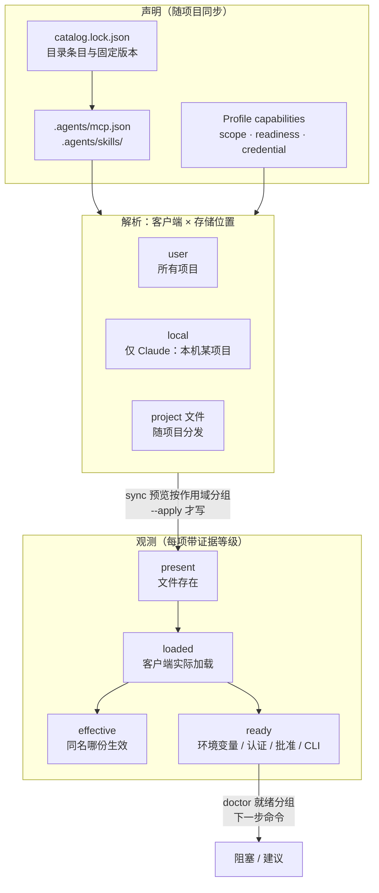

# 多项目、多机下的 MCP 与 Skill 管理：设计文档（#82）

状态：设计稿，待维护者审阅。基线 `v6.13.0`（agent-pack 1.13.0）。本文只描述概念、字段、命令形态、迁移与测试策略，不含代码，不改任何运行时、版本、变更片段或发布载体。
统一讨论：[#82](https://github.com/lc4t/agenthelm/issues/82)；覆盖 #67（作用域与共享）、#69（已安装与已启用、客户端覆盖面）、#72（推荐目录）、#73（新设备就绪检查）；兼容 #68（`--only` / `--replace-mcp` / `--replace-skills`，6.13.0 已发布）。

## 0. 结论摘要

1. **三条正交轴取代各 issue 各自的概念**：*声明*（项目里写什么）、*存储位置*（客户端 × 作用域，条目最终落在哪个文件）、*观测*（文件是否存在、客户端是否加载、哪一份生效、是否就绪）。#67、#69、#72、#73 分别是这三条轴上的缺口，彼此共用同一套数据模型。
2. **声明字段全部放 Profile `capabilities`，不放 `mcp.json`**。`mcp.json` 面向 Agent Plugins 1.0.0，运行时对未知字段直接判不可移植（`agent_pack_config.py:426`、`:430`、`:443`），参考文档也禁止在 MCP 定义里放 adapter 专属字段（`capability-config.md` 安全与碰撞规则）。
3. **能推导的不声明**：`required_env`（来自 `${VAR}` 引用，`_env_references`，`agent_pack_config.py:889`）、`requires_approval`（由客户端与存储位置决定）、stdio 命令是否存在（来自 `command`）均由运行时推导。只有 `auth: oauth`、`requires_cli` 的最低版本与安装提示、作用域和建议等推导不出的信息才需要声明。
4. **每个观测值带证据等级**：`file`（读文件可判定）、`setting`（读设置键可判定）、`cli`（只能问客户端命令行）、`unknown`（官方文档未给出判定手段）。证据不足时不给出「可删除」类结论，直接避免 #69 描述的误删事故。
5. **作用域只收窄不放宽**：声明为 `project` 的条目，永不因回退写进用户级。第一阶段只做 Claude Code 的项目级写入；Codex、Cursor 的项目级放第二阶段（它们的项目文件无法承载机器相关的绝对路径，见 §3 存储映射表）。
6. **Claude desktop 使用新目标 `claude-desktop`，不并入 `claude`**。两点理由：(1) 官方文档说明独立 CLI 不读 `claude_desktop_config.json`，该文件只对 Desktop 应用生效，与 `claude`（CLI）的作用对象不同；(2) 在 Desktop 应用的本地 Code 标签会话中，同名条目使用该文件的定义，并入会改变这些会话的实际生效来源（该优先级仅限 Desktop 本地 Code 标签，不是通用规则，出处见 §2.3）。先只读（inventory/doctor），再可选写入。
7. **共用密钥用「命名的用户级文件」**（`user:<名称>`，固定在 `~/.config/agenthelm/credentials/` 下，权限 0600），不允许任意绝对路径；同时发现 `mcp_env_launcher` 会把 env 文件的全部键注入子进程（`mcp_env_launcher.py:86`），共享文件必须先收窄为「只注入被引用的键」。
8. **推荐目录是一份带固定版本与校验的数据，安装等于「写进项目声明」**，之后沿用既有 `sync` 投递；公开仓库只放通用、可再分发的条目，其余只记来源。
9. **全部新能力对既有项目为 off 或 advisory，本设计没有 major**。会触发 major 的做法（改默认作用域、`--client` 默认包含 desktop、新检查默认阻塞）在各节列为被排除项。
10. 拆分为 11 个可独立排期的 issue（§11），建议顺序 I-1 → I-3 → I-4 → I-7 → I-5 → I-8 → I-9 → I-10 → I-6 → I-12 → I-11。需要维护者拍板的取舍见 §12（15 项），未核实事项见 §13。

**这个领域的标准流程**：多客户端的 Agent 配置管理接近「依赖与配置管理」。标准做法是：声明（项目里写期望）→ 解析（算出每个客户端的目标位置）→ 预览（diff，不写）→ 应用（事务、可回滚）→ 验证（读回并与期望比对）→ 退役（有归档、可恢复）。关键环节是作用域与优先级的显式化、固定版本与校验、以及密钥与配置分离。**当前行业内「好」的判据**主要参考两处：[OpenSSF Scorecard 的 Pinned-Dependencies 检查](https://github.com/ossf/scorecard/blob/main/docs/checks.md)（依赖固定到具体哈希而非可变版本）；[MCP Registry 的 server.schema.json](https://static.modelcontextprotocol.io/schemas/2025-12-11/server.schema.json)（`version` 必须是具体版本、禁止 `latest`；`fileSha256` 对 MCPB 必填、对其他类型可选；环境变量条目带 `isRequired` / `isSecret`）。这两个来源是社区约定，不是对本仓库的强制要求，本文把它们当作目录条目的参照标准（§7）。

---

## 1. 基线：6.13.0 已有的概念与能力

以下均为读源码得到的事实（已读到行号），不含推断。

**项目声明**。Profile 位于 `.agents/moe.sakanano.agent-pack/project.json`，`capabilities` 段由 `load_project_layout` 解析（`agent_pack_config.py:263-321`）：`plugin_roots`、`plugin_dirs`、`skill_roots`、`mcp_sources`、`native_mcp_sources`、`credential_env_file`、`mcp_client_policy`（仅 `include`/`exclude` 按客户端路由，`:286-306`）、`destination_*`。顶层未知键不报错，这使得新增键对旧运行时兼容（旧运行时直接忽略）。所有路径经 `_contained` 限制在项目根内（`:229-236`、`:239-247`）。

**客户端存储位置（agenthelm 当前读写的）**：
- Claude：Skill 链接 `~/.claude/skills/<名>`；MCP 写 `~/.claude.json` 顶层 `mcpServers`（用户级，`_claude_user_config`，`:623-625`）；项目包 `~/.claude/agent-pack/packages/<名>/`、安装记录 `~/.claude/agent-pack/plugins/<名>`、归属状态 `~/.claude/agent-pack/state/<名>.json`（`agent_pack_claude.py:36-42`、`:98`，状态 schema 1，含 `skills` 列表与 `mcps` 字典，`:546-549`）。
- Codex：包在 `~/.agents/plugins/plugins/<名>`，市场条目 `~/.agents/plugins/marketplace.json`，远程 MCP 写 `~/.codex/config.toml`（`agent_pack_codex_mcp.py`）。
- Cursor：`~/.cursor/plugins/local/<名>`；MCP 读 `~/.cursor/mcp.json`。
- `inventory_client` 读取的 Skill 根：codex `~/.codex/skills`、cursor `~/.cursor/skills`、claude `~/.claude/skills`（`:568-577`）；MCP 只读用户级顶层（`_json_client_mcps`，`:640-648`；codex 读 `config.toml` 的 `mcp_servers`，`:628-637`）。**不读** `.mcp.json`、Claude 本地级（`~/.claude.json` 内按项目路径存放的条目）、`~/.agents/skills`、项目级的 `.claude/skills`、`.cursor/mcp.json`、`.codex/config.toml`、`claude_desktop_config.json`。

**#68 在 6.13.0 的形态**：`--only mcp|skills|plugins`（`SYNC_TYPES`，`agent_pack_claude.py:44`，`normalize_only` `:47`）；`--replace-mcp` / `--replace-skills`（`sync_project` `:416`）；冲突按类型计数并提示用户级内容对所有项目生效（`_conflict_summary` `:397`、`_global_warnings` `:404`）；Codex/Cursor 只接受全部类型（`reconcile_project` 内报错）。测试 `plugins/agent-pack/tests/test_sync_only.py`（18 个用例）。CHANGELOG 6.13.0 小节为 `agent-pack 1.13.0`。

**密钥与就绪**：stdio 条目的 `${VAR}` 引用必须在 `credential_env_file`（项目内 dotenv，0600，符号链接拒绝）里存在，缺失时 `sync` 阻塞、`doctor` 报 issue（`_dotenv_keys` `:905-925`，`doctor` `:1970-1986`）。含引用的 stdio 条目被 `mcp_env_launcher.py` 包装，`--env-file` 写入绝对路径（`:1105-1118`）。远程条目的 `${VAR}` 只检查 `os.environ` 非空（`remote_missing_env`，`:1875-1878`）。`doctor` 的退出码取决于 `ok = not issues`（`main` 内 `return 0 if result.get("ok", True) else 1`）。

**对 issue 前提的两处核对结果**：
- #73 写的 `doctor --json` 在 CLI 中实际是 `--output json`（`capability-config.md`「CLI」一节）。
- #73 提到 `doctor` 对这类条目给出 `machine-local` 状态。在本仓库 `agent_pack_config.py` 与 `agent_pack_claude.py` 里没有这个状态；`agent-bootstrap` 只在 SKILL.md 中被引用为项目内 `tools/agent-bootstrap`（`plugins/agent-pack/skills/agent-pack/SKILL.md:13`），不在本仓库。该状态的来源**未确认**，本设计以仓库内的 `doctor` 为准。

---

## 2. 概念模型

### 2.1 图



### 2.2 术语与取值

- **组件类型**（type）：`mcp`、`skills`、`plugins`（项目包与安装记录，是前两者的载体）。沿用 #68。
- **作用域**（scope，声明层）：`user`（所有项目生效）与 `project`（仅该项目）。声明层只有这两个值。
- **存储位置**（store，解析层）：作用域与客户端共同决定。例如 Claude 的 `project` 可以落到 `local`（`~/.claude.json` 内按项目路径存放）或 `project-file`（项目根 `.mcp.json`）。
- **证据等级**（evidence）：`file`、`setting`、`cli`、`unknown`，随每个观测值输出。
- **就绪项**（readiness item）：`{kind, subject, client, store, severity, state, evidence, next}`，`next` 是下一步命令或文档指引，**永不包含值**。

### 2.3 各客户端的真实存储与优先级（官方文档）

Claude Code（[MCP 文档](https://code.claude.com/docs/en/mcp)、[Skills 文档](https://code.claude.com/docs/en/skills)、[Desktop 文档](https://code.claude.com/docs/en/desktop)）：
- MCP 有三种作用域。Local：当前项目，私有，存于 `~/.claude.json`（文档原文「Claude Code stores it in `~/.claude.json` under that project's path」）；Project：项目根 `.mcp.json`，可入版本库；User：所有项目，存于 `~/.claude.json`。
- 同名优先级（「Scope hierarchy and precedence」）：local > project > user > 插件提供 > claude.ai 连接器；「The entire server entry from that source is used; fields are not merged across scopes」。
- `.mcp.json` 的 `${VAR}` 与 `${VAR:-default}` 展开可用于 `command`、`args`、`env`、`url`、`headers`；未设置且无默认值时原样保留并在 `claude mcp list` 给出警告。
- 项目级 `.mcp.json` 在交互会话里需要批准（「Claude Code prompts for approval in interactive sessions before using project-scoped servers from `.mcp.json` files」）；`claude mcp reset-project-choices` 重置；`claude -p`、Agent SDK 等场景不询问。批准相关设置键为 `enableAllProjectMcpServers`、`enabledMcpjsonServers`、`disabledMcpjsonServers`；不受信任目录中项目设置文件里的批准键被忽略，用户设置里的有效，任一设置文件里的 `disabledMcpjsonServers` 都会拒绝。
- `claude mcp list` 输出连接状态（`✔ Connected`、`! Needs authentication`、`✘ Failed to connect`）与配置决策状态（`⏸ Pending approval`、`✘ Rejected`、`⊘ Disabled for this project`、`✘ Blocked by enterprise managed policy`）；后一类「printed without connecting」。OAuth 用 `/mcp` 或 `claude mcp login <name>` / `logout`；令牌「stored securely」，文档不给文件路径。
- Skill：个人 `~/.claude/skills/`、项目 `.claude/skills/`（从启动目录向上到仓库根）、插件命名空间、企业；**同名优先级 企业 > 个人 > 项目**（「With `deploy` in both `~/.claude/skills/` and the project's `.claude/skills/`, `/deploy` runs the personal one」）。随附的内置 Skill 如 `/doctor`、`/code-review`、`/batch`、`/debug`、`/loop`、`/claude-api`；同名用户 Skill「replaces the bundled command」；`disableBundledSkills`、`skillOverrides` 可调整。
- Desktop：「Desktop and CLI read the same configuration files」，`~/.claude.json` 与 `.mcp.json` 中的 MCP 两边通用；Desktop 另外把 `claude_desktop_config.json` 的服务器加载进本机 Code 标签会话，**同名时的优先级只在 Desktop 应用的本地 Code 标签会话中成立**，原文：「If you define the same server name in `claude_desktop_config.json` and in `~/.claude.json` or `.mcp.json`, the Code tab in local sessions connects once and uses the `claude_desktop_config.json` definition」（[Desktop 文档「MCP servers from the Claude Desktop chat app」一节](https://code.claude.com/docs/en/desktop#mcp-servers-from-the-claude-desktop-chat-app)）。同一节还写明：`~/.claude.json` 顶层（用户级）与 `.mcp.json` 同名 stdio 条目时，Code 标签使用 `~/.claude.json` 的定义，与 CLI 的作用域层级不同；独立 CLI 不读该文件，macOS 与 WSL 上可用 `claude mcp add-from-claude-desktop` 复制。

Claude desktop 配置文件（[MCP 官方文档：连接本地服务器](https://modelcontextprotocol.io/docs/develop/connect-local-servers)）：macOS `~/Library/Application Support/Claude/claude_desktop_config.json`，Windows `%APPDATA%\Claude\claude_desktop_config.json`，Linux `~/.config/Claude/claude_desktop_config.json`；结构 `{"mcpServers": {名: {command, args, env}}}`；改后需完全退出并重启；日志在 `~/Library/Logs/Claude`（macOS）下的 `mcp.log` 与 `mcp-server-<名>.log`。文档示例只有 stdio 条目，且路径要求绝对路径。

Codex（[MCP](https://learn.chatgpt.com/docs/extend/mcp?surface=cli)，`developers.openai.com/codex/mcp` 308 重定向至此；[高级配置](https://learn.chatgpt.com/docs/config-file/config-advanced)；[Skills](https://learn.chatgpt.com/docs/build-skills)）：
- MCP：默认 `~/.codex/config.toml`；项目级 `.codex/config.toml`「only for trusted projects」，未受信任的项目跳过项目层、用户层仍加载；多个项目层「the closest file to your working directory wins」。CLI、IDE 扩展与桌面版共用同一配置。键：`command`、`args`、`env`、`env_vars`、`cwd`、`url`、`bearer_token_env_var`、`http_headers`、`env_http_headers`、`enabled`、`required` 等。`codex mcp add|list|login`；OAuth 客户端密钥写在 `config.toml`，令牌存放位置文档未说明。
- Skill：仓库 `.agents/skills`（从当前目录到仓库根逐级扫描）、用户 `$HOME/.agents/skills`、管理员 `/etc/codex/skills`、系统内置；同名「Codex doesn't merge them; both can appear in skill selectors」；`[[skills.config]]` 里 `enabled = false` 可停用；内置系统 Skill 为 `skill-creator`、`skill-installer`。

Cursor（[MCP](https://cursor.com/docs/context/mcp)、[Skills](https://cursor.com/docs/skills)）：
- MCP：项目 `.cursor/mcp.json`、全局 `~/.cursor/mcp.json`；**两者同名的优先级文档未说明**；变量 `${env:NAME}`、`${workspaceFolder}`、`${userHome}`；OAuth 通过远程条目的 `auth` 对象配置静态客户端；启用/停用在界面 Customize 中切换（「Disabled servers won't load」），文档没有 CLI 子命令。
- Skill：项目 `.agents/skills/`、`.cursor/skills/`；用户 `~/.agents/skills/`、`~/.cursor/skills/`；**兼容加载** `.claude/skills/`、`.codex/skills/`、`~/.claude/skills/`、`~/.codex/skills/`；同名优先级文档未说明；有一组内置 Skill（`/review`、`/loop`、`/create-skill` 等）。

> **三个直接影响设计的事实**：
> (a) Codex 与 Cursor 本来就从项目的 `.agents/skills` 加载 Skill，所以 Skill 的项目级对它们等于「不写任何东西」；只有 Claude Code 需要往 `.claude/skills` 投递。
> (b) Claude 的 Skill 优先级是个人 > 项目：另一个项目同步到用户级的同名 Skill 会静默压过本项目的项目级 Skill，`doctor` 必须能检出。
> (c) Cursor 兼容加载 `~/.claude/skills`，所以 Claude 的 Skill 链接同时被 Cursor 读到；跨客户端「重复」要按客户端分别判断，不能只看文件。

---

## 3. 问题 1：作用域（#67）

### 现状
- `sync --client claude` 只写用户级：`~/.claude.json` 顶层 `mcpServers` 与 `~/.claude/skills`（`agent_pack_claude.py:311-324`，MCP 写入见 `:337-346`，路径来自 `core._claude_user_config`）。对「A 声明 `x`、B 不声明，在 A 同步后 B 仍能看到并启动 `x`」的复现，与官方「User：所有项目」一致，无需额外验证。
- 路由维度只有客户端（`mcp_client_policy`，`:286-306`），没有项目或作用域维度。
- `inventory_client` 不读项目级与本地级存储（§1），所以用户级与项目级同名冲突无从检出。
- 预览的 `operations` 无作用域字段；`warnings` 只在有冲突时提示「用户级内容对所有项目生效」（`:404-413`）。

### 选项穷举
- **A. 声明里逐条目标注 `scope`，运行时按客户端映射到具体存储**。
- B. 在 `mcp_client_policy` 里加 `project` 维度。排除：该字段语义是「哪个客户端装」，再塞作用域会让 `include/exclude` 的校验（互斥规则，`:301`）变复杂，且 Skill 没有对应的策略字段。
- C. 用「项目里存在 `.mcp.json`/`.claude/skills` 就当作项目级」的约定、不新增声明。排除：这是隐式契约，`sync` 无法区分「用户手写的项目文件」与「受管条目」，也无法预览作用域迁移。
- D. 只在 CLI 加 `--scope project` 临时开关，不落声明。排除：多机场景下每台机器的命令可以不同，条目作用域会随机器漂移，违背「随项目同步的声明」。
- E. 默认改为项目级（`user` 变为例外）。排除：既有项目的 `sync` 结果会改变，须 major（见下）。作为决策项 D1 保留为「仅新项目模板」的可选项。
- F. 把项目级条目写进共享的 `.mcp.json` 为唯一方案。排除：agent-pack 为含凭据引用的 stdio 条目生成的启动器参数含本机绝对路径（`agent_pack_config.py:1105-1118`），写入随项目同步的文件会在另一台机器上失效。

### 推荐：A，并按存储映射表落地

声明（Profile `capabilities`，仅新增键，旧运行时忽略）：

```json
"capabilities": {
  "default_scope": "user",
  "mcp_scope":   { "<server>": "project" },
  "skill_scope": { "<skill>":  "project" }
}
```
未列出的条目取 `default_scope`，缺省 `user`，行为与 6.13.0 完全相同。

**存储映射表**（声明 `project` 时）：
- **Claude · MCP**：默认写 `local`（`~/.claude.json` 内按项目路径存放，私有、不进版本库；预期不弹批准提示，但文档只对 `.mcp.json` 说明批准、对 local 未说明，该点**未确认**，见 §13）。可选 `--project-store file` 写项目根 `.mcp.json`，**仅当渲染后的条目与机器无关**（无家目录下绝对路径、无密钥值，仅 `${VAR}` 引用）时允许，否则校验失败并提示改用 `local` 或 `user`。
- **Claude · Skill**：`<项目>/.claude/skills/<名>` 指向 `.agents/skills/<名>` 的**相对符号链接**（形态取舍见 D3）。
- **Codex · Skill、Cursor · Skill**：已由项目 `.agents/skills` 原生加载，操作记为 `project-native`（无写入）；若 `skill_roots` 指向 `.agents/skills` 之外，第二阶段再处理。
- **Codex · MCP、Cursor · MCP**：第二阶段。Cursor 的 `.cursor/mcp.json` 支持 `${userHome}`、`${workspaceFolder}`、`${env:}`，可承载与机器无关的条目；Codex 的 `.codex/config.toml` 要求受信任项目，且文档未说明插值，只能承载远程条目（`bearer_token_env_var`、`env_http_headers` 本就只含变量名）与不含绝对路径的 stdio 条目。第一阶段遇到声明为 `project` 的 Codex/Cursor MCP：该条目**跳过并警告**，不回退写入用户级。

**同名优先级的处理**：以各客户端官方文档为准，不自创规则。`doctor` 输出每个同名条目的 `shadowed_by`（Claude：local > project > user；Skill：个人 > 项目；Codex MCP：项目层优先于用户层，依据「Codex reads project overrides from `.codex/config.toml`」；Cursor MCP 与 Skill：文档未说明，只输出 `duplicate-scope (precedence undocumented)` 的建议级提示）。

**作用域迁移**：条目由 `user` 改 `project` 后，预览给出成对操作 `remove-user` + `add-project`，`--apply` 在同一事务与同一恢复目录内完成；由 `project` 改回 `user` 同理。`state` 记录每个条目的 `scope`，无该字段的旧状态按 `user` 读取。

**预览按作用域分组**：每条 `operations` 增加 `scope` 与 `store` 字段，另增汇总 `by_scope`；文本输出按下面分组：
```
[用户级 · 对所有项目生效]   …
[项目级 · 仅此项目 · local]  …
[项目级 · 仅此项目 · 项目文件] …
```
保持既有键不变（`operations`、`conflicts`、`warnings`），只追加。

**屏蔽检测**（依赖 §4 的观测层）：`doctor` 新增三类建议级发现：项目级 Skill 被用户级同名 Skill 屏蔽（Claude 规则 b）；用户级与项目级同名且定义不同；条目只被一个项目使用却装在用户级（需要 §8 的跨项目视图）。

### 对既有项目的影响
- 用户动作：无。不写新键则行为不变。
- 默认值：`default_scope` 缺省 `user`；预览的分组与 `scope` 字段为输出新增，默认 `on`；屏蔽检测默认 `advisory`。
- 等级：minor，非 major。

### 与 #68 兼容
- `--only` 是类型轴，作用域是正交的新轴；新增 `--scope user|project|all`（缺省 `all`）可与 `--only` 组合，例如 `--only skills --scope project`。
- `--replace-mcp` / `--replace-skills` 语义不变；冲突汇总在类型计数之外增加作用域维度。
- `plugins` 类型（包与安装记录）始终是用户级载体；项目级 `local` 条目引用的启动器仍指向该载体，因此 `--only mcp --scope project` 在载体缺失时给出明确错误并提示先同步 `plugins`（与 6.13.0「部分同步仍会安装包」一致）。
- MCP Tool `agent_pack_sync` / `agent_pack_reconcile` 增加 `scope` 参数，缺省行为不变。

**风险 R1（多机混合版本）**：旧运行时会忽略 `mcp_scope` 并把全部条目写用户级，即退回今天的行为，不比现状更糟，但会把「仅限项目」的条目重新放大。缓解：新运行时的 `doctor` 在发现用户级存在应为项目级的受管条目时给出建议；并列为决策项 D15（是否登记最低运行时版本）。

---

## 4. 问题 2：已安装与已启用（#69）

### 现状
- `inventory_client` 只回答「文件存在」：枚举 Skill 目录与 MCP 配置里的条目（`:651-695`），无「已加载」「生效」概念。
- 重复判定只按名字：同名即 `duplicate skill name` / `duplicate MCP name`（`_add_duplicate_issues`，`:714-726`）。
- **根因之一**：codex 的 Skill 根只读 `~/.codex/skills`（`:570`），Codex 官方文档的用户级位置是 `$HOME/.agents/skills`。#69 事故中被误判的「松散副本」恰好在 `~/.agents/skills`，而 `inventory` 看不到它，只看得到包目录，于是把包当作唯一来源。
- Codex 插件是否启用由 `~/.codex/config.toml` 的 `[plugins."<名>@<市场>"] enabled = true` 决定（本仓库 `capability-config.md` 的描述），`inventory` 没有读它。
- 没有内置能力的概念。

### 三种状态的判定能力（逐客户端）

「文件存在」`present`，各客户端均可由 `file` 判定。

「客户端实际加载」`loaded`：
- **Claude Skill**：存在于个人/项目位置即加载，`file` 可判；`disableBundledSkills`、`skillOverrides` 读设置文件，证据 `setting`。
- **Claude MCP**：连接是否成功、是否需要认证只能靠 `claude mcp list`（证据 `cli`；该命令会连接服务器，等于启动 stdio 进程，因此不能在默认 `doctor` 中隐式执行，见 §6 的 `--probe`）。批准与否的权威来源也是 `claude mcp list` 的「Pending approval / Rejected / Disabled」行（文档说明这类状态「printed without connecting」）。批准选择具体落在哪个设置文件，文档没有说明，故只能读到设置键 `enabledMcpjsonServers` / `disabledMcpjsonServers` / `enableAllProjectMcpServers` 的显式值，其余判 `unknown`。
- **Codex MCP**：`enabled = false`、`required` 可读 `config.toml`（`file`）；项目 `.codex/config.toml` 是否生效取决于项目受信任，受信任记录在 `config.toml` 中的具体键文档未给出，判 `unknown`（**未确认**）。
- **Codex Skill**：`[[skills.config]] enabled = false` 可读（`setting`，文档给出）；
- **Codex 插件**：读 `[plugins."<名>@…"] enabled`（`setting`，依据本仓库参考文档，**客户端侧官方文档未核对**，见 §13）。
- **Cursor**：停用开关在界面中，文档没有给出落盘位置，`loaded` 判 `unknown`，只报 `present`。
- **Claude desktop**：是否加载只能重启后看界面；`mcp.log` 可作弱证据，本设计不采用，判 `unknown`。

「被内置能力覆盖」`overridden-by-builtin`：用一份**随版本发布的内置能力表**（客户端 × 名称，每条带官方文档 URL 与核对日期，并标 `exhaustive: false`，因为官方文档用「such as」列举）。命中时只输出建议级提示，措辞按该客户端的官方规则：Claude 为「用户 Skill 替换同名内置命令」，Codex 为「两者都出现在选择器」，Cursor 同名规则未说明。当前能由官方文档确认的条目：Claude Code 的 `/doctor`、`/code-review`、`/batch`、`/debug`、`/loop`、`/claude-api`、`/verify`、`/run`、`/skill-doctor`；Codex 的 `skill-creator`、`skill-installer`；Cursor 的 `/automate`、`/review`、`/loop`、`/create-skill` 等 19 项（逐项见其 Skills 文档）。#69 提到的「Codex 内置文档、表格、演示文稿、PDF 能力」在官方 Skills 文档的内置列表中**未出现**，**未确认**，不入表。

### 选项穷举
- **A. 保留 `present` 为 inventory 默认，新增 `loaded` / `effective` 字段与证据等级，默认全由文件与设置推导；`--probe` 才调用客户端命令行**。
- B. 在 `doctor` 里直接执行 `claude mcp list`、`codex mcp list`。排除：会启动 stdio 子进程、可能联网，违反「预览/检查不应有副作用」的约束，并且 `check`/SessionStart 钩子会每次触发。
- C. 只扩展 `_add_duplicate_issues`：重复时给出「未必可删」提示。排除：没有解决「谁生效」，仍是文字警告。
- D. 不做内置能力表，只在文档说明。排除：#69 明确要求 `doctor` 列出并在发现同名时提示；表可以带出处与「非穷举」标记，维护成本低。

### 推荐：A

**观测记录**（`inventory --source client:X` 与 `doctor --client X` 的新增键，旧键不变）：
```
{ name, kind, client, store,
  present: true,
  loaded: "yes" | "no" | "disabled" | "untrusted" | "pending-approval" | "needs-auth" | "unknown",
  evidence: "file" | "setting" | "cli" | "unknown",
  shadowed_by: { store, reason } | null,
  builtin: { client, name, source_url } | null }
```
**重复归类**取代单一的 `duplicate …`：`shadowed`（有一份确定生效、其余被屏蔽）、`both-load`（Codex 同名两份都出现）、`inert`（存在但客户端不加载）、`unknown-effective`（证据不足）。**只有当全部副本的 `loaded` 都已确定时，才输出「可清理」候选；否则只给 `unknown-effective` 与确认步骤。** 这条规则直接对应 #69 的事故。

补读存储：`~/.agents/skills`（codex、cursor 的用户级）、项目 `.claude/skills`、项目 `.mcp.json`、Claude 本地级、`.cursor/mcp.json`、`.codex/config.toml`、`[plugins]`/`[[skills.config]]` 的启用键。文件解析失败一律降级为 `unknown`，不抛错。

### 对既有项目的影响
- 用户动作：无。
- 默认值：新增字段为输出追加，默认 `on`；重复归类与内置能力提示默认 `advisory`，**不改变 `doctor` 的 `ok` 与退出码**；补读 `~/.agents/skills` 可能让「同名重复」的数量变化，这是修复，等级 patch，见 I-1。
- 等级：观测层 minor；仅补读 `~/.agents/skills` 的修正 patch。

### 与 #68 兼容
纯只读，不触及 `--only`。`--only` 与观测无关；`state` 文件不变。

---

## 5. 问题 3：客户端覆盖面（#69）

### 现状
`inventory`、`doctor`、`sync` 的客户端集合为 `codex`、`cursor`、`claude`（`doctor` 的 `--client` choices，`:2062`）。`claude_desktop_config.json` 不被读取。

### 官方文档事实
见 §2.3：位置（三平台）、格式（`mcpServers` + `command/args/env`，文档示例仅 stdio）、改后需完全重启；Desktop 应用的本地 Code 标签会加载它，且仅在该场景下同名时它的定义优先于 `~/.claude.json` 与 `.mcp.json`；独立 CLI 不读（出处与原文见 §2.3）。文档没有说明该文件是否支持 `${VAR}` 展开与远程 `url` 条目（**未确认**）。

### 选项穷举
- **A. 新增目标 `claude-desktop`**（独立 store、独立 state）。
- B. 作为 `claude` 的第二个写入位置（`claude` 同时写两处）。排除：(1) 独立 CLI 不读该文件，两者作用对象不同；(2) 仅在 Desktop 应用的本地 Code 标签会话中，该文件压过 `~/.claude.json` 与 `.mcp.json`，把条目同步进去会改变这些会话的实际生效来源；(3) 既有 `--client claude` 用户会悄悄多写一个文件，属不兼容，须 major；(4) 生命周期不同（需重启 Desktop，不是「restart Claude Code」）；(5) Desktop 没有 Skill 目录与项目级，`--only` 的类型轴不适用。
- C. 不管理，仅在 `doctor` 里提示存在。排除：#69 的目的是 CLI 与 Desktop 同机配置漂移，只提示没有解决「多机同步时桌面端要手工维护」。
- D. 采用官方 `claude mcp add-from-claude-desktop` 的方向（Desktop → CLI）。排除：方向相反（该命令把 Desktop 配置复制进 `~/.claude.json`，仅 macOS 与 WSL），不能承载「项目声明 → Desktop」。

### 推荐：A，分两期
- **第一期（只读）**：`inventory --source client:claude-desktop`、`doctor --client claude-desktop`；`doctor --client claude` 增加一条检查：若 `claude_desktop_config.json` 里存在与受管条目同名的服务器，报 `shadowed-by claude_desktop_config.json`，并注明「仅对 Desktop 应用的本地 Code 标签会话成立，独立 CLI 不受影响」（证据 `file`，依据同一官方段落）。
- **第二期（可选写入）**：`sync --client claude-desktop` 默认预览、`--apply` 写入，**只处理 MCP**（Desktop 没有 Skill 目录），并且：只写与机器无关或经启动器包装的条目；含凭据引用的条目通过既有 `mcp_env_launcher` 间接取值，**文件里不写密钥值**；因文档未说明插值，条目中的 `${VAR}` 在第二期一律不直接写入该文件。写入前后保留文件原有的其他键，旧内容进恢复目录。`--client` 的任何默认集合都**不包含** `claude-desktop`，须显式点名。
- 路径解析：macOS、Linux 按上述位置；Windows 为 `%APPDATA%\Claude\…`，仓库当前对 Windows 的支持范围**未确认**（决策项 D14）。

### 对既有项目的影响
- 用户动作：无；只读期不写任何文件。
- 默认值：`off`（须显式 `--client claude-desktop`）；`shadowed-by` 提示为 `advisory`。
- 等级：第一期 minor，第二期 minor。若把 desktop 并入 `claude` 的默认写入则为 major（被排除）。

### 与 #68 兼容
`--only` 对 `claude-desktop` 只接受 `mcp`（等价于不带），与「Codex/Cursor 只接受全部类型」的既有处理一致：其他取值明确报错、不写入。`--replace-mcp` 在该目标上等同 `--replace`。

---

## 6. 问题 4：本机认证与就绪（#69、#73）

### 现状
- `doctor` 的就绪相关项只有：`credential env file missing key`、`credential env file must be mode 0600`（`_dotenv_keys`，`:905-925`）、远程条目缺失环境变量（`:1977-1978`，读 `os.environ`）。它们进入 `issues`，直接影响 `ok` 与退出码。
- 无 OAuth 状态、无项目 MCP 待批准、无外部命令行工具检查，也没有「阻塞/建议」分级。

### 声明字段设计：先推导、后声明

| 就绪项 | 来源 | 是否需要声明 |
| --- | --- | --- |
| 环境变量键缺失 | 条目里的 `${VAR}`（`_env_references`） | 否，推导 |
| 密钥文件存在、0600、键齐全 | `credential_env_file` | 否，沿用现有检查 |
| 项目 MCP 待批准 | 客户端 × 存储位置（仅 Claude `.mcp.json`） | **否**，推导；`requires_approval` 字段不设 |
| stdio 命令是否存在 | 条目的 `command` | 否，推导 |
| 命令最低版本、安装提示 | 无法推导 | 是，`requires_cli` |
| 需要 OAuth | 远程条目的 URL 不足以判断 | 是，`auth: "oauth"` |

`requires_approval` 排除理由：批准是（客户端、存储位置）的属性，同一个条目写到 Claude `local` 不需要批准、写到 `.mcp.json` 需要；写成条目字段会与 `--project-store` 的选择产生漂移。

声明形态（Profile `capabilities`，键按服务器名）：
```json
"readiness": {
  "mode": "advisory",
  "mcp": {
    "<server>": {
      "auth": "oauth",
      "requires_cli": [
        { "name": "uvx", "min_version": "0.4.0", "install_hint": "安装方式见上游文档" }
      ],
      "severity": "blocking"
    }
  }
}
```

**放置位置选择**：
- A. Profile `capabilities.readiness`（推荐）。与 `mcp_client_policy` 同族，旧运行时忽略未知键。
- B. `mcp.json` 条目内。排除：未知字段会让条目判不可移植（`:426-436`），并违反参考文档「禁止在 MCP 定义中放入 adapter 专属字段」。
- C. 独立边车文件 `.agents/moe.sakanano.agent-pack/readiness.json`。排除：`capabilities` 已承载同类的路由与路径配置，再拆文件增加两处一致性；留作 Profile 过大时的后备。

### 阻塞与建议的分级
- `mode`：`off`（不评估新分组）、`advisory`（报告但不影响 `ok`/退出码）、`on`（`severity: blocking` 的未满足项进入 `issues`）。缺省 `advisory`。
- 严重度由「声明」与「证据」共同决定：证据已确定且未满足 → 取声明的 `severity`（缺省 `blocking`，仅 `mode: on` 时影响退出码）；证据 `unknown`（例如 OAuth 状态无法读文件）→ 降为建议级「无法核实」并附下一步。**已有的环境变量键与密钥文件检查保持原样（仍为 `issues`）。**

### 各就绪项的判定与「下一步」

- **密钥键缺失**：只报键名；下一步指向向 `credential_env_file` 补键。一点补充：对 Claude Desktop、Cursor 等图形界面客户端，`doctor` 所在 shell 的环境与客户端进程的环境不一定相同；这是推断（Desktop 文档的故障排查提示「重启应用以加载环境变量」），不是文档对 Cursor 的明确说明，输出里标证据为「本 shell 的进程环境」而不是「客户端环境」。
- **项目 MCP 待批准**（仅 Claude `.mcp.json`）：读到显式的批准或拒绝设置时 `loaded` 为确定值；否则 `unknown`，建议级提示。`--probe` 时解析 `claude mcp list` 的「Pending approval」行。下一步：在项目目录运行 `claude` 并批准，或在**用户**设置中配置 `enabledMcpjsonServers`（文档说明不受信任目录里的项目设置批准键被忽略）。
- **OAuth**：Claude 只能经 `claude mcp list`（`! Needs authentication`）判定，令牌位置文档不提供，**agenthelm 不读任何令牌存储**；Codex 的 `codex mcp list` 是否显示认证状态文档未说明（**未确认**）；Cursor 无命令行。默认输出建议级 `oauth-unverified` 与下一步：Claude `claude mcp login <名>`（或 `/mcp`），Codex `codex mcp login <名>`，Cursor 在 Customize 界面登录。`--probe` 且为 Claude 时可给出确定结果。
- **外部命令行工具**：`command` 与 `requires_cli.name` 只接受**裸可执行名**（不含路径分隔符），只在 `PATH` 中解析（`shutil.which`），不经 shell。最低版本只在 `--probe` 下，用固定白名单参数（`--version`、`version`、`-V`）执行并解析。**安全理由**：项目声明由仓库提供，`doctor` 又会被会话钩子触发；允许项目指定任意路径或参数会变成「打开仓库即执行」。

`--probe` 约束：默认关闭；`check`、SessionStart 钩子与 MCP 只读 Tool 一律不执行；执行时输出所调用的命令清单；子进程输出只解析状态词，不回显。

**输出**：`doctor` 增加 `readiness`：`{mode, summary:{blocking, advisory}, items:[{kind, subject, client, store, severity, state, evidence, next}]}`，`--output json` 供 Agent 使用。由声明生成的「新设备清单」即该输出；项目不必再维护散文式清单文档。#73 的「`--json`」对应现有 `--output json`，不新增别名。

### 与现有 `credential_env_file` 的关系
`credential_env_file` 保持「密钥来源」的单一职责；`readiness` 只声明「需要什么」。`required_env` 不设独立字段，以推导为准；若一个 `${VAR}` 不在任何来源里，沿用现有 `credential env file missing key`。扩展见 §8。

### 对既有项目的影响
- 用户动作：无。新分组默认 `advisory`，已有检查的行为与退出码不变。
- 默认值：`readiness.mode` 缺省 `advisory`；`--probe` 默认 `off`；声明字段不存在时只产生推导出的建议级项。
- 等级：minor。若新检查默认进入 `issues`，既有项目的 CI 会变红，属不兼容须 major（被排除）。

### 与 #68 兼容
就绪项按（客户端、存储位置）输出，`--only` 不影响 `doctor`；`doctor --client claude` 在 `--only` 部分同步后可能出现「未同步的类型」，与既有 `missing`/`stale` 分类一致，不新增状态。

---

## 7. 问题 5：推荐目录（#72）

### 现状
agenthelm 没有目录概念；`transfer` 可从来源（`client:…`、`project:…`）导入组件到项目，`retire` 通过 `reconcile --retire-skill/--retire-plugin`。仓库里已有「按内容包独立版本」的机制（CHANGELOG 6.11.0 列出 `agents-init/project-contract` 等内容包），但其版本由模板变化驱动，是否适合承载「目录数据」**未核实**（决策项 D11）。

### 数据格式（每个条目一个 JSON 文件，`schema: 1`）
```json
{
  "schema": 1,
  "id": "example-notes",
  "kind": "mcp",
  "title": { "zh": "…", "en": "…" },
  "purpose": { "zh": "…", "en": "…" },
  "clients": ["claude", "codex", "cursor"],
  "source": {
    "type": "npm | pypi | git | url | docs-only",
    "identifier": "包名或仓库地址",
    "version": "1.2.3",
    "commit": "40 位完整 SHA（git 类型必填）",
    "license": "SPDX 标识",
    "redistribution": "reference-only | vendored"
  },
  "integrity": { "sha256": "64 位十六进制", "covers": "archive | tree | registry-artifact" },
  "install": { "mcp": { "…": "可移植 mcp.json 条目，只含 ${VAR} 引用" }, "skill": { "dir": "…" } },
  "env": [ { "name": "EXAMPLE_TOKEN", "required": true, "secret": true, "obtain": "获取方式（链接或步骤）" } ],
  "auth": "env | oauth | none",
  "requires_cli": [ { "name": "uvx", "min_version": "0.4.0", "install_hint": "…" } ],
  "scope_advice": { "scope": "user | project", "reason": "…" },
  "limitations": [ "…" ],
  "status": "active | deprecated | retired",
  "replaced_by": "条目 id（可空）"
}
```
字段取舍依据：`version` 必须是具体版本、禁止 `latest` 与范围、`integrity.sha256`、`env[].required/secret` 直接参照 [MCP Registry server.schema.json](https://static.modelcontextprotocol.io/schemas/2025-12-11/server.schema.json) 的 `Package.version`（「Must be a specific version」）、`fileSha256`、`isRequired`、`isSecret`；固定到 commit 或哈希参照 [Scorecard Pinned-Dependencies](https://github.com/ossf/scorecard/blob/main/docs/checks.md)。`env[].secret` 只说明「是否敏感」，目录里**永不出现值**。

### 选项穷举
- **A. 目录是随 agent-pack 发布的数据文件；安装 = 把条目写进项目声明（`mcp.json`/`skills`、Profile 的 `readiness`/`mcp_scope`），并在项目里写 `catalog.lock.json` 记录来源；之后沿用 `sync` 投递到客户端**。
- B. 目录条目直接安装到客户端（绕过项目声明）。排除：产生「只存在于某台机器」的能力，违背多机同步的前提；`doctor` 又会把它们当作 `native`（用户自配）。
- C. 做成远程服务（在线目录）。排除：需要网络与更新策略，公开仓库无法保证条目长期可用；先把离线数据与校验做对。
- D. 目录条目内嵌第三方内容（vendored）。排除为默认：许可证与再分发风险；只有许可证清单允许再分发的条目可标 `vendored`，其余只记来源。
- E. 把每个条目做成独立的 agent-pack 插件。排除：插件整体由发布流程单独计算版本，条目增删会放大发布面。

### 推荐：A

**命令形态**（沿用「默认预览、`--apply` 才写」）：
```
agent-pack catalog list   [--client claude] [--kind mcp|skill] [--output json]   # 只读
agent-pack catalog show   <id>                                                    # 只读：来源、固定版本、所需环境变量名与获取方式、限制
agent-pack catalog install <id> --project P [--scope user|project]                # 默认预览；--apply 写项目声明与 catalog.lock.json
agent-pack catalog retire  <id> --project P                                       # 默认预览；--apply 移除声明，客户端侧用 reconcile --retire-* 归档
agent-pack catalog verify  [--project P]                                          # 只读：校验条目与锁文件，供 doctor 调用
```
`catalog install` 的预览必须展示 apply 之后项目里的声明 diff 与将来 `sync` 会产生的操作列表（「预览要反映 apply 的结果」）。安装后的指引输出所需环境变量**名**、获取方式与建议作用域，**不含任何值**。

**固定与校验的两种模式**（决策项 D12）：
- Skill（文件类）：`fetch` 模式，agenthelm 下载归档，核对 `integrity.sha256` 后落入项目，沿用 6.12.0 中 Cursor 更新已有的「下载后校验 SHA-256」做法（CHANGELOG 6.12.0）。
- MCP（stdio 经 `npx`/`uvx` 启动）：`pinned-launch`：条目写死精确版本（如 `pkg@1.2.3`、`pkg==1.2.3`），`integrity` 记录目录收录时核对过的制品摘要；运行期由客户端拉取，agenthelm **无法**在每次启动时校验，`doctor` 只能检查参数里的版本是否仍等于目录固定值。此局限写入条目的 `limitations` 并在 `show` 里提示。

**状态识别**：`catalog.lock.json`（项目内，随项目同步）记录 `{id, version/commit, entry_digest, installed_scope}`。`inventory`/`doctor` 据此给出每个条目的状态：`installed`、`outdated`（目录有新的固定版本）、`deprecated`、`retired-upstream`、`drifted`（项目里的声明与目录条目不一致）；缺少环境变量沿用就绪分组。

**公开仓库准入规则**（成为 CI 校验，见 I-9）：
- `source.license` 必须在 SPDX 允许清单内才可标 `vendored`；否则只能 `reference-only`，目录文件不含任何第三方副本。
- `source.version` 具体版本、git 类必须给 40 位 `commit`；拒绝 `latest`、范围、分支名。
- 条目文本与示例不得含个人路径、内部主机名、令牌形字符串（扩展现有 `tests/test_public_privacy.py` 的标记与 `_portable_mcp` 的密钥检测）。
- 个人配置与内部服务**只记录来源**，由用户在自己的私有来源里管理（#72 的边界）。

### 对既有项目的影响
- 用户动作：无。目录默认不安装、不随 agenthelm 自动安装。
- 默认值：`off`。`doctor` 仅在项目存在 `catalog.lock.json` 时才评估目录状态。
- 等级：schema、校验与只读命令 minor；install/retire minor；每个新增条目为数据变更，patch。

### 与 #68 兼容
`catalog install` 只写项目声明，不直接触碰客户端，所以不引入新的 `--only` 取值；投递由既有 `sync --only mcp|skills` 完成。`catalog retire` 在客户端侧复用 `reconcile --retire-skill`，其不受 `--only` 过滤的既有语义保持不变。

---

## 8. 问题 6：共用密钥与共享清单（#67）

### 现状
- `credential_env_file` 只能是项目内相对路径：`_resolve_profile_paths` 对每个路径调用 `_contained`，越出项目根即报错（`agent_pack_config.py:239-247`、`:280-283`）。符号链接指向项目外同样被 `resolve()` 判越界。
- 只能指定一个文件。
- `mcp_sources`、`plugin_roots` 同样限制在项目内，没有跨项目共享位置。
- `mcp_env_launcher.py:86` 把 env 文件的**全部键**合并进子进程环境（`environment.update(load_dotenv(...))`），不论条目是否引用。当文件只服务一个项目时影响有限；**多项目共享同一文件后，每个 MCP 子进程都能看到所有键**，违反最小暴露。
- 跨项目的重复没有发现机制；归属状态按项目包名分文件（`~/.claude/agent-pack/state/<名>.json`），内容为本项目装进 Claude 的 Skill 与 MCP（`agent_pack_claude.py:546-549`）。

### 选项穷举（密钥文件）
- **A. 命名的用户级文件**：`"credential_env_file": "user:<名称>"`，解析到固定根 `$XDG_CONFIG_HOME/agenthelm/credentials/<名称>.env`（缺省 `~/.config/agenthelm/credentials/`），目录 0700、文件 0600，名称限 `[a-z0-9-]+`。
- B. 允许任意绝对路径或 `~/` 路径。排除：Profile 随仓库而来，恶意或被污染的项目可把路径指向任何用户文件，启动器会把其中所有键注入到项目声明的命令里，等价于任意文件读取并交给项目指定的进程。
- C. 多个文件列表（`["…", "user:shared"]`）。保留为 A 的补充：项目文件与共享文件并用。
- D. 只用进程环境，取消 dotenv。排除：GUI 客户端不继承 shell 环境（Desktop 文档的故障排查对环境变量有提示），且这会删除现有工作流。
- E. 项目内符号链接指向共享文件。排除：当前即被 `_contained` 拒绝，放行会让「越界」检查失效。

### 推荐：A + C，并收窄注入范围
- 语法：`credential_env_file` 接受字符串（沿用，项目内相对路径）、`user:<名称>`、或列表。列表中键重复时**项目内文件优先**，`doctor` 输出被覆盖的键名（只报名）。
- **按引用注入**：对 `user:` 文件，启动器只导出被条目 `${VAR}` 引用的键。项目内文件保持旧行为（全部导出），以免破坏依赖未引用键的既有条目；是否统一收窄见决策项 D9。
- 检查：`user:` 文件必须 0600、目录 0700、非符号链接；缺失时 `doctor` 输出名称与创建指引，不创建文件、不写值。
- **兼容性**：旧运行时读到 `user:foo` 会按项目内相对路径解析并因文件不存在而阻塞（`credential env file missing or unsafe`），读到列表会在 `_resolve_profile_paths` 报「project profile paths must be non-empty strings」；两者都是**显式失败而非静默错用**，但意味着采用新语法的项目要求所有机器先升级运行时。

### 共享清单（多个项目引用同一份 MCP/Skill 定义）
选项：
- **S0. 零新概念**：用 git 子模块或普通目录放共享清单，由各项目的 `mcp_sources` / `skill_roots` 指向项目内的该目录（真实目录，不是指向项目外的符号链接）。当前代码即可工作。
- S1. 目录条目（§7）作为共享介质：各项目安装同一条固定版本的条目，共享对象是固定版本，文件各存一份。
- S2. 新增 `shared:<名称>` 位置（用户级目录，解析到 `~/.config/agenthelm/shared/<名称>/`）。排除为第一阶段：引入第二套权威来源，`doctor` 与 `transfer` 都要理解它；也让项目声明依赖机器上的文件。
- S3. 允许 `mcp_sources` 写任意外部路径。排除：同 B 的路径注入问题。

推荐：第一阶段采用 S0 + S1，**不新增共享位置**（决策项 D10），在文档里写清 S0 的做法。

### 重复发现
- 单项目内：既有 `duplicate MCP name`（`mcp_sources` 间）保持；
- 跨项目（同一台机器）：新增只读 `doctor --machine`，读取 `~/.claude/agent-pack/state/*.json`（每个项目一份归属记录），输出：同名条目被多个项目归属；内容相同的重复（对规范化配置求摘要，不输出配置值）；内容不同的同名冲突；用户级条目只被一个项目归属（建议改 `project`）。**局限**：只能看到在本机同步过的项目，没同步过的不可见；不扫描文件系统寻找项目。
- 用户级与项目级同名：见 §3 的屏蔽检测。

### 对既有项目的影响
- 用户动作：无；采用 `user:`、列表或按引用注入才需要，且要求所有机器的运行时先升级。
- 默认值：新语法 `off`（不写则不生效）；`doctor --machine` 只读，`advisory`。
- 等级：minor。若把 `credential_env_file` 的注入默认改为按引用，会改变既有条目行为，须 major（被排除，见 D9）。

### 与 #68 兼容
无关 `--only`；`doctor --machine` 与 `sync` 的归属状态共用同一份 `state`，`state` 追加 `scope` 字段（旧文件读作 `user`），不升 `STATE_SCHEMA`。

---

## 9. 约束的落实（验收条件）

以下是每个实施 issue 都必须满足的横切验收条件。

1. **写命令默认预览，`--apply` 才写**。新增的 `catalog install|retire`、`sync --client claude-desktop`、项目级写入全部遵守；并在 `docs/write-commands.md` 的命令盘点与 `tests/test_i18n_commands.py` 的 PREVIEW 登记中补录。只读命令（`catalog list|show|verify`、`doctor --machine`、`doctor --probe`）登记 READ_ONLY，且运行前后磁盘不变（该测试已有此类检查）。`--probe` 虽执行外部命令，但不写盘，登记时在原因里注明。
2. **预览反映 apply 的结果**。预览与 `--apply` 走同一个规划函数（6.13.0 的 `plan_project` 即是这样做的），同一输入同一 `ok`、退出码与消息；新增「作用域迁移」「目录安装」必须有「预览 = 应用」的对照测试：对同一夹具，预览返回的操作列表与 `--apply` 实际改动的文件集合逐项相等。
3. **只处理环境变量名**。所有新输出（就绪项、目录条目、重复发现、`--probe` 解析）不含令牌值、不读取令牌存储（Claude 的 OAuth 令牌位置文档不公开，**不读**）；测试用已知的假令牌写入夹具，断言它不出现在任何输出、日志、恢复目录元数据里。
4. **对既有项目的影响写明用户动作与默认值**。每个 issue 的草稿都含「影响既有项目」「用户动作」「默认 off/advisory/on」；`release/changes` 片段的 `default_for_existing`、`user_action_required` 据此填写。
5. **不兼容按 major**。以下做法触发 major，被本设计排除，如要采纳须另立决策：改变默认作用域；让 `--client` 默认包含 `claude-desktop`；让新检查默认进入 `issues`；改变 `credential_env_file` 对既有条目的注入范围；删除或重命名既有 JSON 输出键。
6. **作用域只收窄不放宽**：声明为 `project` 的条目在任何回退路径里不写用户级。
7. **证据不足不给破坏性结论**：`unknown` 证据的重复项不出现「可删除」建议。
8. **新输出键只追加**。既有 `operations`、`conflicts`、`warnings`、`clients.<客户端>` 各键与含义不变，`--output json` 的消费者无需修改。

---

## 10. 迁移与测试策略

### 迁移
- 所有新声明键缺省即旧行为；既有项目**零迁移**。
- 采用顺序对用户可见：先升级所有机器的运行时 → 再在 Profile 添加新键。旧运行时对新键的表现：`mcp_scope`、`readiness`、`catalog` 被忽略（退回今天的行为，见 R1）；`credential_env_file` 的新语法显式失败（§8）。
- 多机混合版本：旧运行时读不到新键，因而无法自己发现版本过旧。决策项 D15 的「最低运行时版本」声明由新运行时在写入新键时一并写入，供新版本的 `doctor` 与人工参考；旧运行时无法检查，只能靠文档与变更说明提示。
- 作用域迁移（用户级 ↔ 项目级）为成对操作、同一事务、同一恢复目录，可回滚；预览逐项列出。

### 测试（沿用 `plugins/agent-pack/tests/` 的临时 HOME 夹具风格，参见 `test_sync_only.py`）
- **观测层**：夹具里同时放包目录与 `~/.agents/skills` 松散副本、未启用的 `[plugins]`，断言 `loaded` / `shadowed_by` / 证据等级，并断言 `unknown` 时无「可清理」输出（复现 #69）。
- **作用域**：A 声明 `x` 为项目级、B 不声明；同步 A 后断言用户级配置无 `x`、`local` 存储有 `x`，在 B 的项目路径下读不到；用户级 ↔ 项目级迁移的事务与回滚；Claude Skill 个人 > 项目的屏蔽检出。
- **预览 = 应用**：对每个新写操作做操作列表与实际改动文件集合的等价测试。
- **兼容**：既有 `test_sync_only.py` 全部保持通过；新增测试断言「不写新键时，`sync` 的 `operations`、`state`、磁盘内容与 6.13.0 字节一致」（以基线 tag 的输出为参照）。
- **密钥安全**：假令牌不入输出；`user:` 路径遍历（`..`、符号链接、大小写绕过）拒绝；按引用注入时未引用键不进入子进程环境。
- **`--probe` 安全**：`requires_cli.name` 含路径分隔符、空白、`..` 一律拒绝；不经 shell；默认路径（`doctor`、`check`、钩子）不执行任何外部命令（用打桩的 `subprocess` 断言零调用）。
- **目录**：schema 校验、`latest`/范围/分支名拒绝、许可证与 `vendored` 的关联、隐私标记扫描、`catalog install` 预览与应用等价、退役后 `doctor` 状态。
- **官方文档漂移**：内置能力表、各客户端路径表带出处 URL 与核对日期；增加一个只读脚本（不入 CI 默认）供维护者复核。
- **CI**：新增文档只在 `docs/design/` 下，不在 `tests/i18n-policy.json` 的配对范围（该清单只覆盖 README、INSTALL 与 `plugins/*/references`、`plugins/*/skills`，见 `tests/test_i18n_policy.py`）。实施 issue 若修改 `capability-config.md`，需遵守该清单（该文件目前登记为待翻译）。

---

## 11. 拆分的 issue 草稿与建议顺序

等级含义沿用 `release/VERSIONING.md`：patch 兼容修复或小改进，minor 值得发布说明的新能力，major 不兼容。以下每项均不是 major。

**I-1 观测层：区分「存在 / 加载 / 生效」并补读缺失的存储**（minor，agent-pack；其中补读 `~/.agents/skills` 可单独作为 patch）
- 范围：§4。读 `~/.agents/skills`、项目 `.claude/skills`、`.mcp.json`、Claude 本地级、`.cursor/mcp.json`、`.codex/config.toml`、`[plugins]`/`[[skills.config]]` 启用键；观测记录与证据等级；重复归类；内置能力表（带出处）。
- 影响既有项目：输出追加；`~/.agents/skills` 补读会改变「同名重复」计数（advisory，不改 `ok`）。用户动作：无。默认：观测字段 on，提示 advisory。
- 依赖：无。关闭 #69 §二、§三。
- 验收：#69 夹具不再误判；`unknown` 不出现「可清理」；既有 JSON 键不变；`ok`/退出码不变。
- 测试：§10「观测层」与「兼容」。

**I-3 `doctor` 本机就绪分组**（minor，agent-pack）
- 范围：§6。`readiness` 输出、`capabilities.readiness`、推导项、`auth: oauth`、`requires_cli`、`--probe`、`mode`。
- 影响：默认 `advisory`，不改 `ok`/退出码；用户动作：无。
- 依赖：I-1（复用证据等级与存储读取）。关闭 #73、#69 §四。
- 验收：JSON 含 `next` 且无值；`--probe` 默认关闭、钩子不执行外部命令；裸可执行名约束。
- 测试：§10「密钥安全」「`--probe` 安全」。

**I-4 作用域声明与 Claude 项目级写入**（minor，agent-pack）
- 范围：§3。`default_scope`、`mcp_scope`、`skill_scope`；Claude `local` / `.mcp.json` / `.claude/skills`；`--scope`、`--project-store`；预览按作用域分组；作用域迁移；屏蔽检测。
- 影响：不写新键则行为不变；用户动作：无。默认 `user`；预览分组 on；屏蔽检测 advisory。
- 依赖：I-1。关闭 #67 §一、§二、§四。
- 验收：#67 复现（A、B 两项目）不再泄漏；预览 = 应用；声明为 `project` 的条目无回退写用户级；`state` 追加 `scope`。
- 测试：§10「作用域」「预览 = 应用」。

**I-7 共用密钥：`user:<名称>` 与按引用注入**（minor，agent-pack）
- 范围：§8。`credential_env_file` 新语法、固定根目录与权限检查、启动器按引用注入（仅 `user:` 文件）。
- 影响：新语法 off；旧运行时对新语法显式失败，用户动作：先升级所有机器。
- 依赖：无。关闭 #67 §三 与 #67「期望」第二条。
- 验收：路径遍历全部拒绝；未引用键不进子进程环境；错误只含名称。
- 测试：§10「密钥安全」。

**I-5 `claude-desktop` 只读**（minor，agent-pack）
- 范围：§5 第一期。`inventory`/`doctor` 读 `claude_desktop_config.json`；`doctor --client claude` 的 `shadowed-by` 提示。
- 影响：`off`（须点名客户端）；`shadowed-by` advisory。用户动作：无。
- 依赖：I-1。关闭 #69 §一（读部分）。
- 验收：三平台路径解析（macOS、Linux 实测，Windows 按 D14）；文件缺失/损坏降级为 `unknown`。
- 测试：临时 HOME 夹具。

**I-8 跨项目重复发现 `doctor --machine`**（minor，agent-pack）
- 范围：§8 重复发现。
- 影响：只读，advisory。依赖：I-4（`state` 含 `scope`）。关闭 #67「期望」第三条后半。
- 验收：不输出配置值；不扫描文件系统；局限写入输出说明。

**I-9 推荐目录：schema、校验与只读命令**（minor，agent-pack）
- 范围：§7。条目 schema、准入校验（固定版本、SPDX、`vendored` 规则、隐私扫描）、`catalog list|show|verify`；暂不收录条目。
- 影响：`off`。依赖：无（与 I-3 的 `requires_cli`/`env` 字段共用定义，建议 I-3 先行）。关闭 #72 §一。
- 验收：`latest`/范围/分支名拒绝；公开条目的许可证关联规则有测试；`list|show` 登记 READ_ONLY。

**I-10 目录安装与退役、`catalog.lock.json`、`inventory`/`doctor` 识别**（minor，agent-pack）
- 范围：§7。`catalog install|retire`、锁文件、状态（`installed`/`outdated`/`deprecated`/`drifted`）、Skill 的 fetch+SHA-256、MCP 的 pinned-launch。
- 影响：`off`；用户动作：显式安装。依赖：I-9、I-3、I-4。关闭 #72 §二至§四。
- 验收：预览 = 应用；安装后指引只含变量名；退役经 `reconcile --retire-*` 归档并可恢复。

**I-6 `claude-desktop` 可选写入**（minor，agent-pack）
- 范围：§5 第二期。仅 MCP；启动器间接取值；不写 `${VAR}`；旧内容进恢复目录。
- 影响：`off`。依赖：I-5、I-7（凭据路径稳定后）、D5 拍板。关闭 #69 §一（写部分）。
- 验收：`--client` 默认集合不含该目标；文件里无密钥值；回滚测试。

**I-12 Codex / Cursor 项目级 MCP**（minor，agent-pack）
- 范围：§3 第二阶段。Cursor `.cursor/mcp.json`（用 `${userHome}`、`${workspaceFolder}` 保持与机器无关）；Codex `.codex/config.toml`（受信任项目；仅远程条目与无绝对路径 stdio）。
- 影响：`off`。依赖：I-4。验收：与机器相关的条目被拒绝并给出原因；未受信任项目给出 `untrusted` 提示。

**I-11 首批目录条目**（patch × N，agent-pack，数据）
- 范围：由维护者选定的通用、可再分发条目；每条经 I-9 校验。依赖：I-9、I-10；D13 拍板。

**建议顺序**：I-1 → I-3 → I-4 → I-7 → I-5 → I-8 → I-9 → I-10 → I-6 → I-12 → I-11。
理由：I-1 是后续所有判定的地基；I-3 复用它并最快回应 #73；I-4 回应 #67 的主诉求；I-7 体量小且独立，放在 I-4 后与 `state` 变更错开；I-5 先于 I-6 以便先观察再写入；目录依赖就绪字段与作用域，放后；首批条目最后。I-1、I-7 无相互依赖，可并行。

---

## 12. 决策项（需维护者拍板）

下表「倾向」是我的建议，「替代视角」列出另一种合理立场。我擅长的是读文档与代码、结构化比较；以下几项涉及产品取向与风险偏好，最终由维护者决定。

1. **D1 默认作用域**。倾向：保持 `user`，新项目模板不变。替代：新建项目的模板默认 `project`（对既有项目无影响，但属于模板语义变化，须填 `template_changes`）。
2. **D2 Claude 项目级 MCP 的默认存储**。倾向：`local`（私有、无批准弹窗风险、可含机器路径）。替代：`.mcp.json`（团队共享、可入版本库，但需批准且必须与机器无关）。
3. **D3 Claude 项目级 Skill 的形态**。倾向：相对符号链接 `.claude/skills/<名> → ../../.agents/skills/<名>`。替代：复制（无链接问题，但双份真相）；仅在 Windows 或同步盘不支持链接时降级为复制。同步盘对符号链接的行为**未核实**。
4. **D4 desktop 作为新目标还是并入 `claude`**。倾向：新目标 `claude-desktop`（§5 理由）。替代：并入并要求 major。
5. **D5 是否写入 `claude_desktop_config.json`**。倾向：只读先行，写入作为独立后续（仅 MCP、启动器间接取值）。替代：永远只读，改由官方 `claude mcp add-from-claude-desktop` 同步方向负责。
6. **D6 `readiness.mode` 缺省值**。倾向：`advisory`。替代：`on`（对既有项目会改变 `ok`，须 major）。
7. **D7 `--probe` 的开放范围**。倾向：仅显式 `--probe`，钩子与 MCP 只读 Tool 一律不执行。替代：允许在 `doctor` 的交互模式默认执行 `claude mcp list`（体验更好，但有副作用）。
8. **D8 用户级凭据文件的引用方式**。倾向：命名引用 `user:<名称>`、固定根目录。替代：允许绝对路径（灵活，但引入路径注入，见 §8 B）。
9. **D9 启动器注入范围**。倾向：仅对 `user:` 文件按引用注入，项目内文件保持旧行为。替代：全面收窄（更安全，改变既有行为，须 major）。
10. **D10 共享清单位置**。倾向：第一阶段不新增位置，用子模块/目录加目录条目固定版本。替代：新增 `shared:<名称>` 用户级位置。
11. **D11 目录的载体**。倾向：随 agent-pack 发布的数据文件。替代：复用「内容包」机制独立计版。内容包机制是否适合承载此类数据**未核实**。
12. **D12 目录 MCP 的固定方式**。倾向：stdio MCP 用 `pinned-launch`（精确版本），Skill 用「下载 + SHA-256」。替代：MCP 也由 agenthelm 下载校验后本地运行（可校验，但引入安装与运行代码的信任面）。
13. **D13 首批条目与许可证策略**。倾向：先只放 `reference-only` 的条目，`vendored` 需逐条审议许可证。条目的选择是产品判断，交回维护者。
14. **D14 Windows 支持范围**。倾向：第一阶段只支持 macOS 与 Linux 的路径解析与符号链接；Windows 路径仅写入文档。仓库当前对 Windows 的支持程度**未确认**。
15. **D15 最低运行时版本的登记**。倾向：新运行时在写入新声明键时，同时在 Profile 写 `capabilities.requires_agent_pack`（供新版本检查与人工参考；旧版本无法检查）。替代：不登记，依赖变更说明。

---

## 13. 未核实清单

标「未确认」表示我未能从官方一手来源或仓库内容证实，设计里已按保守方式处理。

1. Claude Code 的 **local 作用域条目是否弹出批准**：文档只对 `.mcp.json` 说明批准。`~/.claude.json` 中按项目路径存放条目的**确切键名与结构**，文档只说「under that project's path」。
2. Claude Code **批准选择落在哪个设置文件**：文档只说明了相关键名与「不受信任目录中项目设置里的批准键被忽略」。
3. Claude Code 的 **OAuth 令牌存储位置**：文档仅说「stored securely」。agenthelm 不读取，故不影响设计，但无法提供文件级判定。
4. Codex：**项目受信任记录在 `config.toml` 中的具体键**；`codex mcp list` **是否显示认证状态**；MCP OAuth **令牌位置**；`.codex/config.toml` 是否支持变量插值。
5. Codex 插件启用键 `[plugins."<名>@<市场>"] enabled` 仅来自本仓库的参考文档，**未对照 Codex 官方文档**。
6. Cursor：`.cursor/mcp.json` 与 `~/.cursor/mcp.json` **同名优先级**；Skill 同名优先级；MCP 启用/停用开关的**落盘位置**；是否有 `mcp list` 一类命令行。
7. Claude desktop：该文件在 Desktop 本地 Code 标签中的同名优先级是否随 Desktop 版本变化（官方页面未标注版本范围，本文取自 2026-11-11 的页面）；`claude_desktop_config.json` 是否支持 **`${VAR}` 展开**与**远程 `url` 条目**；Windows 上经 Desktop 的行为差异。官方 Desktop 文档引用到的版本范围以页面为准，本文未逐版本核对。
8. #69 所说「Codex 内置文档、表格、演示文稿、PDF 能力」在官方 Skills 文档的内置列表中**未出现**；内置能力表不收。官方列举多用「such as」，表为非穷举。
9. `agent-bootstrap` 与 `machine-local` 状态不在本仓库，来源**未确认**。
10. 同步盘（iCloud、Dropbox、OneDrive）对**相对符号链接**的行为未实测；`README.md`「同步盘里的 `.venv`」一节只给出 Python 与 Node 环境的实测。
11. 「内容包」机制是否适合承载目录数据**未核实**（未读其生成与计版实现）。
12. `claude mcp list` 的输出格式是人类可读文本，未见稳定的机器可读契约；`--probe` 的解析应当容错，版本变化会使解析降级为 `unknown`。
13. 以上官方文档引用均取自 2026-11-11 的页面内容；`developers.openai.com/codex/*` 当日重定向到 `learn.chatgpt.com`，页面地址以重定向后为准。Claude Code 文档页面较长，本文只核对了与本设计相关的章节，其余章节（例如 `managed-mcp.json` 的细节）**未读**。

---

## 14. 术语对照表

- Agent Plugins：Agent 插件规范 1.0.0
- Profile：项目档案（`project.json`）
- MCP（Model Context Protocol）：模型上下文协议
- stdio：标准输入输出传输
- OAuth（Open Authorization）：开放授权
- SPDX（Software Package Data Exchange）：软件包数据交换标识
- SHA-256：安全散列算法（256 位）
- local / user / project 作用域：本地级 / 用户级 / 项目级（Claude Code）
- readiness：就绪（本机运行环境是否具备）
- evidence：证据等级
- pinned-launch：固定版本启动
- probe：探测（执行客户端命令行以取得状态）
